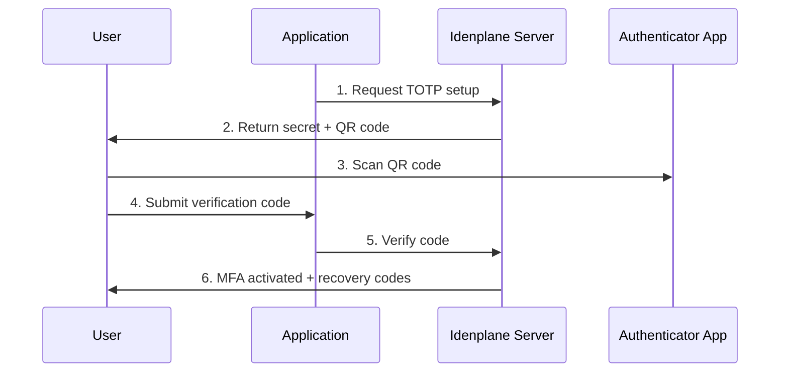
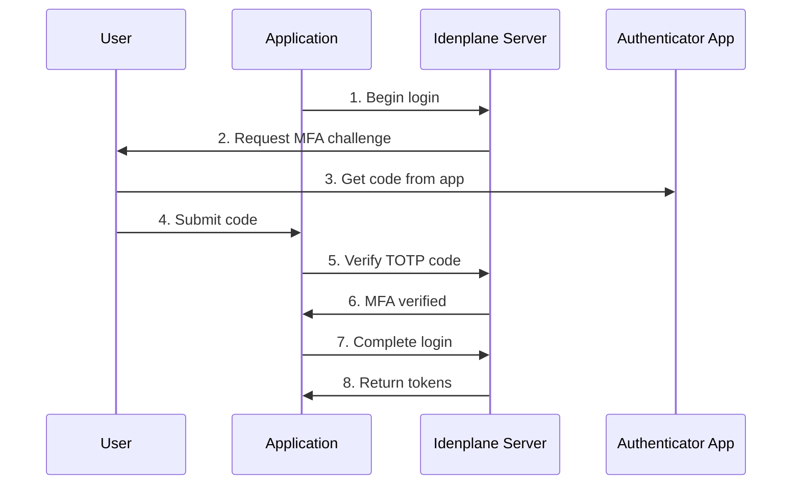

# MFA Guide

Multi-Factor Authentication (MFA) adds an extra layer of security by requiring a second form of verification beyond passwords. Idenplane supports Time-based One-Time Passwords (TOTP) and one-time codes sent by text message (SMS) as second factors, with recovery codes for account recovery.

## Supported Methods

| Method | Description | Security Level |
|--------|-------------|----------------|
| [TOTP](#totp-setup) | Time-based 6-digit codes from authenticator apps (RFC 6238) | High |
| [SMS](#sms-text-message-codes) | One-time codes sent to a verified phone number | Medium |
| [Recovery Codes](#recovery-codes) | Backup codes for account recovery | Fallback |

A user can have an authenticator app, a phone, or both. Every check that decides whether a sign-in needs a second factor counts any of them.

:::caution MFA Required for Admins
Realm administrators may require MFA step-up verification for sensitive operations. API key authentication is not permitted for operations that require MFA verification.
:::

---

## TOTP Setup

The TOTP setup flow involves generating a secret, displaying a QR code for easy enrollment, and verifying the first code to activate MFA.

### Setup Flow



### Step 1: Initiate TOTP Setup

Request TOTP setup for a user:

```bash
curl -X POST "http://localhost:3000/realms/my-realm/mfa/setup" \
  -H "Authorization: Bearer ${ACCESS_TOKEN}" \
  -H "Content-Type: application/json"
```

**Response:**

```json
{
  "secret": "JBSWY3DPEHPK3PXP",
  "qrCodeDataUrl": "data:image/png;base64,iVBORw0KGgoAAAANSUhEUg...",
  "otpauthUrl": "otpauth://totp/Idenplane%20(my-realm)/user@example.com?secret=JBSWY3DPEHPK3PXP&issuer=Idenplane%20%28my-realm%29&algorithm=SHA1&digits=6&period=30"
}
```

### Step 2: Display QR Code

Render the QR code for the user to scan:

```tsx
function TOTPSetup({ setupData }) {
  return (
    <div className="mfa-setup">
      <h2>Set Up Authenticator App</h2>
      <p>Scan this QR code with your authenticator app:</p>
      

      <details>
        <summary>Can't scan? Enter manually</summary>
        <div className="manual-entry">
          <label>Secret Key:</label>
          <code>{setupData.secret}</code>
          <p>Open your authenticator app and enter this secret manually.</p>
        </div>
      </details>
    </div>
  );
}
```

### Step 3: Verify and Activate

After the user scans the QR code, verify the first code to activate MFA:

```bash
curl -X POST "http://localhost:3000/realms/my-realm/mfa/verify" \
  -H "Authorization: Bearer ${ACCESS_TOKEN}" \
  -H "Content-Type: application/json" \
  -d '{
    "verificationCode": "123456"
  }'
```

**Response:**

```json
{
  "success": true,
  "recoveryCodes": [
    "A3F2B8C1",
    "7D4E9F2A",
    "B1C3D8E5",
    "2F9A4C7D",
    "E8B3F1A6",
    "5C7D2E9B",
    "D4A8F3C1",
    "9E2B5D8A",
    "F6C1B3E7",
    "1D4E9A2F"
  ]
}
```

:::warning Save Recovery Codes
Store recovery codes securely. They are the only way to recover access if you lose your authenticator device. Each code can only be used once.
:::

---

## TOTP Verification

After MFA is enabled, users must provide a TOTP code during authentication for sensitive operations.

### Verification Flow



### Standard Login with MFA

When MFA is required, the login flow prompts for a verification code:

```typescript
async function loginWithMfa(
  username: string,
  password: string,
  totpCode: string
): Promise<TokenResponse> {
  // Step 1: Initial authentication
  const loginResponse = await fetch(
    'http://localhost:3000/realms/my-realm/protocol/openid-connect/auth',
    {
      method: 'POST',
      headers: { 'Content-Type': 'application/json' },
      body: JSON.stringify({ username, password }),
    }
  );

  if (loginResponse.status === 403) {
    // MFA required - exchange for challenge token
    const { challengeToken } = await loginResponse.json();

    // Step 2: Verify TOTP code
    const verifyResponse = await fetch(
      'http://localhost:3000/realms/my-realm/mfa/verify',
      {
        method: 'POST',
        headers: {
          'Content-Type': 'application/json',
          'X-MFA-Challenge': challengeToken,
        },
        body: JSON.stringify({ code: totpCode }),
      }
    );

    if (!verifyResponse.ok) {
      throw new Error('Invalid MFA code');
    }

    // Step 3: Complete login with verified session
    return completeLoginFlow(challengeToken);
  }

  return loginResponse.json();
}
```

### Verify TOTP Code

Send the TOTP code for verification:

```bash
curl -X POST "http://localhost:3000/realms/my-realm/mfa/verify" \
  -H "Authorization: Bearer ${ACCESS_TOKEN}" \
  -H "X-MFA-Challenge: ${CHALLENGE_TOKEN}" \
  -H "Content-Type: application/json" \
  -d '{
    "code": "123456"
  }'
```

**Response:**

```json
{
  "verified": true,
  "acr": "urn:idenplane:acr:mfa"
}
```

### Error Handling

```typescript
interface MFAVerificationResponse {
  verified?: boolean;
  error?: string;
  error_description?: string;
  remainingAttempts?: number;
}

async function verifyTotpCode(code: string, challengeToken: string) {
  try {
    const response = await fetch(
      'http://localhost:3000/realms/my-realm/mfa/verify',
      {
        method: 'POST',
        headers: {
          'Content-Type': 'application/json',
          'X-MFA-Challenge': challengeToken,
        },
        body: JSON.stringify({ code }),
      }
    );

    const data: MFAVerificationResponse = await response.json();

    if (!response.ok || data.error) {
      switch (data.error) {
        case 'invalid_code':
          const remaining = data.remainingAttempts ?? 0;
          if (remaining <= 2) {
            throw new Error('Warning: Few attempts remaining before lockout');
          }
          throw new Error(`Invalid code. ${remaining} attempts remaining.`);

        case 'challenge_expired':
          throw new Error('Challenge expired. Please restart the login process.');

        case 'max_attempts_exceeded':
          throw new Error('Maximum attempts exceeded. Account temporarily locked.');
      }
    }

    return data;
  } catch (error) {
    if (error instanceof TypeError) {
      throw new Error('Network error - check connection');
    }
    throw error;
  }
}
```

:::note TOTP Window
Idenplane validates TOTP codes with a window of ±1 step (30 seconds). This accommodates clock skew between the server and authenticator app.
:::

---

## SMS (Text Message Codes)

### Turning it on

In the admin console, open the realm, go to the **SMS** tab, choose a provider (Twilio, Vonage, AWS SNS or a webhook), save it, and switch on **SMS Multi-Factor Authentication**. The switch can't be turned on without a provider.

Turning the switch off stops new phones from being added. Users who already added one keep signing in with it, so nobody is locked out. Removing the provider stops codes from being delivered; those users then sign in with a recovery code.

### Adding a phone

Users add a phone on their account page (**Text Message Verification → Set Up Text Messages**):

1. Enter the number in international format, for example `+201012345678`. Signed-in users also confirm their password, so a hijacked session can't add its own phone.
2. Enter the code that arrives by text message.
3. Save the recovery codes shown, unless the user already has codes from an authenticator app. Those keep working.

Changing the number follows the same steps. The old number keeps working until the new one is confirmed. In a realm that requires MFA, a new user can choose **Use text messages instead** on the setup page and enrol a phone instead of an app.

### Signing in

On the second-factor page, a user with a phone presses **Send code** and enters the texted code. A user who has both an app and a phone can switch between them. The ID token's `amr` claim is `["pwd", "sms"]` after a texted code and `["pwd", "otp"]` after an app or recovery code. Both reach the `urn:idenplane:acr:mfa` level.

### Token API (password grant)

The `mfa_required` response lists the factors the user can answer with:

```json
{
  "error": "mfa_required",
  "mfa_token": "…",
  "mfa_methods": ["totp", "sms", "recovery"]
}
```

To use SMS, request a code for that challenge, then answer it with `mfa_method=sms`:

```bash
# 1. Text a code (authenticate the client exactly as for the token request)
curl -X POST "http://localhost:3000/realms/my-realm/protocol/openid-connect/mfa/sms" \
  -d client_id=my-app -d client_secret=… -d mfa_token=${MFA_TOKEN}
# → { "masked_phone": "+20••••••5678", "expires_in": 300, "resend_after": 30 }

# 2. Answer the challenge
curl -X POST "http://localhost:3000/realms/my-realm/protocol/openid-connect/token" \
  -d grant_type=mfa_otp -d client_id=my-app -d client_secret=… \
  -d mfa_token=${MFA_TOKEN} -d mfa_method=sms -d otp=123456
```

### Step-up

`GET /realms/:realm/step-up/challenge` returns `methods` (for example `["sms", "recovery"]`). For SMS, call `POST /realms/:realm/step-up/sms` with `{ "mfa_token": "…" }`, then `POST /realms/:realm/step-up/verify` with `"method": "sms"` and the code as `otp`.

### Protections

- **Bound codes.** A code only answers the challenge it was sent for: one sign-in, one step-up, or one phone enrolment.
- **Guess limit.** Each challenge allows 5 guesses in total, including after resends.
- **Single use.** A correct code can be used once.
- **Storage.** Codes are stored only as keyed hashes. Phone numbers are encrypted.
- **Sending limits.** A resend needs a 30-second wait. There are caps per challenge, user, phone number, IP address and realm. The realm-wide cap defaults to 1,000 messages an hour and can be changed with `SMS_REALM_HOURLY_LIMIT`. These caps limit the cost of SMS-pumping fraud.
- **No code in logs.** Codes are never logged, and server logs show only the last digits of a number.

:::tip
Text messages can be intercepted, for example through SIM swapping, so SMS is weaker than an authenticator app or a passkey. Offer it for convenience, and encourage users to add an authenticator app for high-value accounts.
:::

---

## Recovery Codes

Recovery codes provide a fallback mechanism when users lose access to their authenticator app or phone. Each code can only be used once. A user gets one set of codes with their first factor; adding a second factor keeps them, and they are removed only together with the last factor.

### Using Recovery Codes

When TOTP is unavailable, users can use a recovery code instead:

```bash
curl -X POST "http://localhost:3000/realms/my-realm/mfa/recovery" \
  -H "Authorization: Bearer ${ACCESS_TOKEN}" \
  -H "X-MFA-Challenge: ${CHALLENGE_TOKEN}" \
  -H "Content-Type: application/json" \
  -d '{
    "recoveryCode": "A3F2B8C1"
  }'
```

**Response:**

```json
{
  "verified": true,
  "remainingCodes": 9
}
```

### Recovery Code Flow

```typescript
async function loginWithRecoveryCode(
  username: string,
  password: string,
  recoveryCode: string
): Promise<TokenResponse> {
  // Initiate login
  const loginResponse = await fetch(
    'http://localhost:3000/realms/my-realm/protocol/openid-connect/auth',
    {
      method: 'POST',
      headers: { 'Content-Type': 'application/json' },
      body: JSON.stringify({ username, password }),
    }
  );

  if (loginResponse.status === 403) {
    const { challengeToken } = await loginResponse.json();

    // Use recovery code instead of TOTP
    const verifyResponse = await fetch(
      'http://localhost:3000/realms/my-realm/mfa/recovery',
      {
        method: 'POST',
        headers: {
          'Content-Type': 'application/json',
          'X-MFA-Challenge': challengeToken,
        },
        body: JSON.stringify({ recoveryCode }),
      }
    );

    if (!verifyResponse.ok) {
      throw new Error('Invalid recovery code');
    }

    return completeLoginFlow(challengeToken);
  }

  return loginResponse.json();
}
```

:::warning One-Time Use
Recovery codes are invalidated after use. Users should store the remaining code count and generate new codes when running low.
:::

### Regenerating Recovery Codes

Users can regenerate their recovery codes (requires current MFA verification):

```bash
curl -X POST "http://localhost:3000/realms/my-realm/mfa/recovery/regenerate" \
  -H "Authorization: Bearer ${ACCESS_TOKEN}" \
  -H "X-MFA-Challenge: ${CHALLENGE_TOKEN}" \
  -H "Content-Type: application/json" \
  -d '{
    "code": "123456"
  }'
```

**Response:**

```json
{
  "recoveryCodes": [
    "2B4E8A1F",
    "9C3D5A7B",
    "E1F6B2C8",
    "D7A3E9B4",
    "5F1C8D2E",
    "A8B4F7C3",
    "3E9D1B5F",
    "C2F8A4E7",
    "B6D3F9A1",
    "7E2C5D8B"
  ]
}
```

---

## Check MFA Status

Check whether a user has MFA enabled:

### User Self-Check

```bash
curl -X GET "http://localhost:3000/realms/my-realm/mfa/status" \
  -H "Authorization: Bearer ${ACCESS_TOKEN}"
```

**Response:**

```json
{
  "enabled": true,
  "method": "totp",
  "verifiedAt": "2024-01-15T10:30:00Z"
}
```

### Admin Check (per user)

```bash
curl -X GET "http://localhost:3000/admin/realms/my-realm/users/${USER_ID}/mfa/status" \
  -H "Authorization: Bearer ${ADMIN_TOKEN}"
```

**Response:**

```json
{
  "enabled": true,
  "methods": ["totp", "sms"]
}
```

`methods` lists the user's verified second factors (`totp` for an authenticator app, `sms` for a phone). `enabled` is true when there is at least one.

---

## Disabling MFA (Admin)

Administrators can disable MFA for users who have lost their authenticator device. This operation requires MFA step-up verification from the admin.

### Requirements

To disable a user's MFA, the administrator must:

1. Authenticate with an active user session (not API key)
2. Complete MFA verification during the request

### Disable MFA for User

```bash
curl -X DELETE "http://localhost:3000/admin/realms/my-realm/users/${USER_ID}/mfa" \
  -H "Authorization: Bearer ${ADMIN_ACCESS_TOKEN}" \
  -H "Cookie: IDENPLANE_SESSION=${ADMIN_SESSION_TOKEN}"
```

This removes every second factor (authenticator app and SMS phone) and the recovery codes. To remove only one factor, use `DELETE .../mfa/totp` or `DELETE .../mfa/sms`; the recovery codes are kept while the user still has another factor.

:::caution MFA Step-Up Required
This operation requires the administrator to have MFA-verified session. API key authentication is not permitted for disabling user MFA.
:::

### Verification Requirements

| Auth Method | Can Disable MFA |
|-------------|-----------------|
| User session + MFA verified | Yes |
| User session (password only) | No |
| API key | No |

### Error Responses

```json
{
  "statusCode": 401,
  "message": "MFA step-up is required to disable user MFA. Please complete MFA verification via POST /realms/:realmName/step-up/verify with acr=urn:idenplane:acr:mfa before retrying."
}
```

```json
{
  "statusCode": 401,
  "message": "MFA step-up is required to disable user MFA. API key authentication is not permitted for this operation."
}
```

---

## TOTP Configuration

Idenplane uses industry-standard TOTP configuration:

| Parameter | Value | Description |
|-----------|-------|-------------|
| Algorithm | SHA1 | HMAC-based one-time password |
| Digits | 6 | 6-digit code |
| Period | 30 | Seconds per code |
| Window | ±1 | Validation tolerance |

### Supported Authenticator Apps

Most TOTP-compatible apps work with Idenplane:

- **Google Authenticator** (iOS / Android)
- **Microsoft Authenticator** (iOS / Android)
- **Authy** (iOS / Android / Desktop)
- **1Password** (iOS / Android / Desktop / Browser)
- **Bitwarden** (iOS / Android / Desktop / Browser)
- **any** TOTP/RFC 6238 compatible app

---

## Security Best Practices

### Enable MFA Early

:::tip Enable MFA Immediately
Enable MFA as soon as account creation is complete. Don't wait for a security incident to prompt enrollment.
:::

### Use Authenticator Apps Over SMS

| Method | Security | Recommendation |
|--------|----------|----------------|
| Authenticator App | High | Recommended |
| Hardware Keys | Highest | Best for high-value accounts |
| SMS | Medium (SIM-swap risk) | Supported; prefer an app for high-value accounts |

### Protect Recovery Codes

```typescript
// Store recovery codes securely
async function storeRecoveryCodes(codes: string[]) {
  // Option 1: Encrypted storage (recommended)
  const encrypted = await encryptWithMasterKey(codes.join('\n'));
  localStorage.setItem('recovery_codes', encrypted);

  // Option 2: Export to file (with warning)
  const blob = new Blob([codes.join('\n')], { type: 'text/plain' });
  const url = URL.createObjectURL(blob);
  // Prompt user to save file securely
}
```

### Monitor Account Activity

```typescript
// Check for suspicious MFA events
async function checkMfaActivity(accessToken: string) {
  const response = await fetch(
    'http://localhost:3000/realms/my-realm/mfa/activity',
    {
      headers: { Authorization: `Bearer ${accessToken}` },
    }
  );

  const activity = await response.json();

  // Alert on unusual patterns
  if (activity.newDeviceCount > 0) {
    notifyUser(`New device(s) added to MFA on ${activity.lastSetupAt}`);
  }
}
```

---

## Error Codes

| Code | Description | Action |
|------|-------------|--------|
| `invalid_code` | TOTP code is invalid or expired | Enter a new code from authenticator |
| `challenge_expired` | MFA challenge has expired | Restart the authentication flow |
| `max_attempts_exceeded` | Too many failed attempts | Wait 5 minutes or use recovery code |
| `mfa_required` | MFA is required for this operation | Complete MFA verification |
| `invalid_recovery_code` | Recovery code is invalid or used | Try another recovery code |

---

## Next Steps

<div style={{display: 'grid', gridTemplateColumns: 'repeat(2, 1fr)', gap: '1rem', marginTop: '2rem'}}>

[**Authentication Guide**](/guides/authentication)
Learn about OAuth 2.0 and OIDC authentication flows

[**Authorization Guide**](/guides/authorization)
Understand RBAC and access control policies

[**API Reference**](/api)
Complete REST API documentation with examples

[**React SDK**](/guides/sdks/react-sdk)
Integrate Idenplane into your React application

</div>

---

<p align="center">
  <a href="https://idenplane.com">idenplane.com</a> &middot;
  <a href="https://github.com/idenplane/idenplane">GitHub</a> &middot;
  <a href="https://discord.gg/idenplane">Discord</a>
</p>
