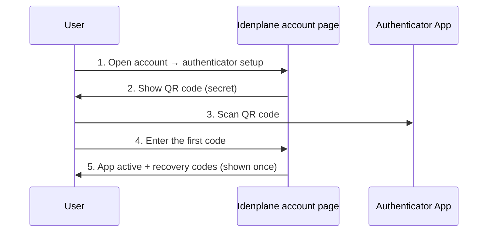

# MFA Guide

Multi-Factor Authentication (MFA) adds an extra layer of security by requiring a second form of verification beyond passwords. Idenplane supports Time-based One-Time Passwords (TOTP) and one-time codes sent by text message (SMS) as second factors, with recovery codes for account recovery.

## Supported Methods

| Method | Description | Security Level |
|--------|-------------|----------------|
| [TOTP](#totp-setup) | Time-based 6-digit codes from authenticator apps (RFC 6238) | High |
| [SMS](#sms-text-message-codes) | One-time codes sent to a verified phone number | Medium |
| [Recovery Codes](#recovery-codes) | Backup codes for account recovery | Fallback |

Passkeys (WebAuthn) are a separate sign-in method; they reach the highest ACR level, `urn:idenplane:acr:webauthn`.

A user can have an authenticator app, a phone, or both. Every check that decides whether a sign-in needs a second factor counts any of them.

:::caution MFA Required for Admins
Realm administrators may require MFA step-up verification for sensitive operations. API key authentication is not permitted for operations that require MFA verification.
:::

---

## TOTP Setup

Users enrol an authenticator app on Idenplane's own pages. There is no JSON API for a user to set up TOTP: the pages hold the secret and the QR code.

### Where users enrol

- **Account page.** A signed-in user opens `/realms/{realm}/account/totp-setup`, scans the QR code, and enters the first code to confirm it. `/realms/{realm}/account/totp-disable` removes the app again.
- **At sign-in.** In a realm with `mfaRequired` on, a user without a second factor is sent to the enrolment page after the password and has to enrol before the sign-in completes.



The user gets 10 recovery codes with their first factor. They are shown once; save them.

---

## TOTP Verification

### Browser sign-in

After the password, a user with a second factor sees the second-factor page (`/realms/{realm}/totp`) and enters a code from the app, a texted code, or a recovery code. Applications using the authorization code flow need no extra code for this: the redirect back to the application happens after the second factor.

### Token API (password grant)

With the password grant, a user with MFA gets an `mfa_required` error instead of tokens:

```json
{
  "error": "mfa_required",
  "mfa_token": "…",
  "mfa_methods": ["totp", "recovery"]
}
```

Answer it with the `mfa_otp` grant, authenticating the client as for the first request:

```bash
curl -X POST "http://localhost:3000/realms/my-realm/protocol/openid-connect/token" \
  -d grant_type=mfa_otp -d client_id=my-app -d client_secret=… \
  -d mfa_token=${MFA_TOKEN} -d otp=123456
```

`otp` takes a code from the authenticator app or a recovery code. For a texted code, add `mfa_method=sms` (see below). A wrong code returns `invalid_grant`; the `mfa_token` allows a limited number of attempts and expires after a few minutes.

---

## SMS (Text Message Codes)

### Turning it on

In the admin console, open the realm, go to the **SMS** tab, choose a provider (Twilio, Vonage, AWS SNS or a webhook), save it, and switch on **SMS Multi-Factor Authentication**. The switch can't be turned on without a provider.

Turning the switch off stops new phones from being added. Users who already added one keep signing in with it, so nobody is locked out. Removing the provider stops codes from being delivered; those users then sign in with a recovery code.

### Adding a phone

Users add a phone on their account page (**Text Message Verification → Set Up Text Messages**):

1. Enter the number in international format, for example `+201012345678`. Signed-in users also confirm their password, so a hijacked session can't add its own phone.
2. Enter the code that arrives by text message.
3. Save the recovery codes shown, unless the user already has codes from an authenticator app. Those keep working.

Changing the number follows the same steps. The old number keeps working until the new one is confirmed. In a realm that requires MFA, a new user can choose **Use text messages instead** on the setup page and enrol a phone instead of an app.

### Signing in

On the second-factor page, a user with a phone presses **Send code** and enters the texted code. A user who has both an app and a phone can switch between them. The ID token's `amr` claim is `["pwd", "sms"]` after a texted code and `["pwd", "otp"]` after an app or recovery code. Both reach the `urn:idenplane:acr:mfa` level.

### Token API (password grant)

The `mfa_required` response lists the factors the user can answer with:

```json
{
  "error": "mfa_required",
  "mfa_token": "…",
  "mfa_methods": ["totp", "sms", "recovery"]
}
```

To use SMS, request a code for that challenge, then answer it with `mfa_method=sms`:

```bash
# 1. Text a code (authenticate the client exactly as for the token request)
curl -X POST "http://localhost:3000/realms/my-realm/protocol/openid-connect/mfa/sms" \
  -d client_id=my-app -d client_secret=… -d mfa_token=${MFA_TOKEN}
# → { "masked_phone": "+20••••••5678", "expires_in": 300, "resend_after": 30 }

# 2. Answer the challenge
curl -X POST "http://localhost:3000/realms/my-realm/protocol/openid-connect/token" \
  -d grant_type=mfa_otp -d client_id=my-app -d client_secret=… \
  -d mfa_token=${MFA_TOKEN} -d mfa_method=sms -d otp=123456
```

### Step-up

`GET /realms/:realm/step-up/challenge` returns `methods` (for example `["sms", "recovery"]`). For SMS, call `POST /realms/:realm/step-up/sms` with `{ "mfa_token": "…" }`, then `POST /realms/:realm/step-up/verify` with `"method": "sms"` and the code as `otp`.

### Protections

- **Bound codes.** A code only answers the challenge it was sent for: one sign-in, one step-up, or one phone enrolment.
- **Guess limit.** Each challenge allows 5 guesses in total, including after resends.
- **Single use.** A correct code can be used once.
- **Storage.** Codes are stored only as keyed hashes. Phone numbers are encrypted.
- **Sending limits.** A resend needs a 30-second wait. There are caps per challenge, user, phone number, IP address and realm. The realm-wide cap defaults to 1,000 messages an hour and can be changed with `SMS_REALM_HOURLY_LIMIT`. These caps limit the cost of SMS-pumping fraud.
- **No code in logs.** Codes are never logged, and server logs show only the last digits of a number.

:::tip
Text messages can be intercepted, for example through SIM swapping, so SMS is weaker than an authenticator app or a passkey. Offer it for convenience, and encourage users to add an authenticator app for high-value accounts.
:::

---

## Recovery Codes

Recovery codes provide a fallback mechanism when users lose access to their authenticator app or phone. Each code can only be used once. A user gets one set of codes with their first factor; adding a second factor keeps them, and they are removed only together with the last factor.

### Using Recovery Codes

A recovery code is entered wherever a second factor is asked for:

- on the second-factor page during browser sign-in;
- as the `otp` of the `mfa_otp` grant (see [Token API](#token-api-password-grant));
- in a step-up, with `"method": "recovery"`.

Codes are 8 hexadecimal characters, and each one works once. There is no endpoint to regenerate them: a user who has used up their codes removes and re-enrols the factor, which issues a new set.

---

## Check MFA Status

Users see their factors on their account page. Administrators can check any user:

### Admin Check (per user)

```bash
curl -X GET "http://localhost:3000/admin/realms/my-realm/users/${USER_ID}/mfa/status" \
  -H "Authorization: Bearer ${ADMIN_TOKEN}"
```

**Response:**

```json
{
  "enabled": true,
  "methods": ["totp", "sms"],
  "passkeys": 1
}
```

`methods` lists the user's verified second factors (`totp` for an authenticator app, `sms` for a phone). `enabled` is true when there is at least one. `passkeys` (since 0.13.0) counts the user's passkeys (WebAuthn credentials) apart, since a passkey is a sign-in of its own rather than a step after the password: a user with only passkeys has `enabled: false` and `passkeys` above 0.

To list them:

```bash
curl "http://localhost:3000/admin/realms/my-realm/users/${USER_ID}/mfa/passkeys" \
  -H "Authorization: Bearer ${ADMIN_TOKEN}"
```

Each entry has `id`, `friendlyName`, `deviceType`, `backedUp`, `transports`, `createdAt` and `lastUsedAt`; never the public key.

---

## Disabling MFA (Admin)

Administrators can disable MFA for users who have lost their authenticator device. This operation requires MFA step-up verification from the admin.

### Requirements

To disable a user's MFA, the administrator must:

1. Authenticate with an active user session (not API key)
2. Complete MFA verification during the request

### Disable MFA for User

```bash
curl -X DELETE "http://localhost:3000/admin/realms/my-realm/users/${USER_ID}/mfa" \
  -H "Authorization: Bearer ${ADMIN_ACCESS_TOKEN}" \
  -H "Cookie: IDENPLANE_SESSION=${ADMIN_SESSION_TOKEN}"
```

This removes every second factor (authenticator app and SMS phone), the recovery codes and, since 0.13.0, **every passkey** of the user. To keep the passkeys, add `?keepPasskeys=true` (any value other than `true` or `false` is refused with `400`). To remove only one factor, use `DELETE .../mfa/totp` or `DELETE .../mfa/sms`; the recovery codes are kept while the user still has another factor. To remove one passkey:

```bash
curl -X DELETE "http://localhost:3000/admin/realms/my-realm/users/${USER_ID}/mfa/passkeys/${PASSKEY_ID}" \
  -H "Authorization: Bearer ${ADMIN_ACCESS_TOKEN}"
```

`PASSKEY_ID` is the `id` from the list above. It needs the same MFA step-up as the other routes here.

**Why a full reset removes passkeys by default.** A reset is what an admin does to recover an account, often one that was taken over. A passkey signs the user in on its own, without the password, so a passkey registered by whoever had the account would keep them in after a reset that left it. Idenplane stores no flag saying whether a passkey is used for passwordless sign-in or as a step-up, so the reset cannot tell an attacker's passkey from the user's own. The safe default is to remove them all; the admin keeps them only by asking (`keepPasskeys=true`, or **Keep the user's passkeys** in the console's **Reset MFA** dialog), or removes single unknown ones from the user's **Security** tab. If the user signs in with passkeys only, set them a password first, or they cannot sign in after the reset. This matches the admin console's own reset (`DELETE /admin/admin-accounts/{id}/mfa`), which has always removed passkeys. Keycloak has no single reset: its admin console deletes credentials one by one on the user's **Credentials** tab, passkeys included.

Each of these routes also **signs the user out everywhere** (since 0.12.0): every OAuth session ends and its refresh tokens are revoked, offline tokens included, and every browser SSO and forward-auth proxy session ends. Whoever signed in with the removed factor, or got past it, has to sign in again. Access tokens already issued stay valid until they expire.

:::caution MFA Step-Up Required
This operation requires the administrator to have MFA-verified session. API key authentication is not permitted for disabling user MFA.
:::

### Verification Requirements

| Auth Method | Can Disable MFA |
|-------------|-----------------|
| User session + MFA verified | Yes (also for removing a passkey) |
| User session (password only) | No |
| API key | No |

### Error Responses

```json
{
  "statusCode": 401,
  "message": "MFA step-up is required to disable user MFA. Please complete MFA verification via POST /realms/:realmName/step-up/verify with acr=urn:idenplane:acr:mfa before retrying."
}
```

```json
{
  "statusCode": 401,
  "message": "MFA step-up is required to disable user MFA. API key authentication is not permitted for this operation."
}
```

---

## TOTP Configuration

Idenplane uses industry-standard TOTP configuration:

| Parameter | Value | Description |
|-----------|-------|-------------|
| Algorithm | SHA1 | HMAC-based one-time password |
| Digits | 6 | 6-digit code |
| Period | 30 | Seconds per code |
| Window | ±1 | Validation tolerance |

### Supported Authenticator Apps

Most TOTP-compatible apps work with Idenplane:

- **Google Authenticator** (iOS / Android)
- **Microsoft Authenticator** (iOS / Android)
- **Authy** (iOS / Android / Desktop)
- **1Password** (iOS / Android / Desktop / Browser)
- **Bitwarden** (iOS / Android / Desktop / Browser)
- **any** TOTP/RFC 6238 compatible app

---

## Security Best Practices

### Enable MFA Early

:::tip Enable MFA Immediately
Enable MFA as soon as account creation is complete. Don't wait for a security incident to prompt enrollment.
:::

### Use Authenticator Apps Over SMS

| Method | Security | Recommendation |
|--------|----------|----------------|
| Authenticator App | High | Recommended |
| Passkeys (WebAuthn) | Highest | Best for high-value accounts |
| SMS | Medium (SIM-swap risk) | Supported; prefer an app for high-value accounts |

### Protect Recovery Codes

Tell users to keep recovery codes offline, for example printed or in a password manager. Anyone with a code and the password can pass the second factor.

### Monitor Account Activity

MFA events are recorded in the realm's events (when `eventsEnabled` is on) and can be sent to a webhook: `user.mfa_challenge`, `user.mfa_verify` and `user.mfa_verify_error`. See [Webhooks](./webhooks.mdx).

---

## Error Codes

| Where | Response | Meaning |
|------|-------------|--------|
| Token endpoint | `mfa_required` with `mfa_token` | The user has a second factor; answer with the `mfa_otp` grant |
| Token endpoint | `invalid_grant`, "Invalid OTP code" | Wrong code; try again with the same `mfa_token` |
| Token endpoint | `invalid_grant`, "Invalid or expired MFA token, or too many failed attempts" | Start the sign-in again |

---

## Next Steps

<div style={{display: 'grid', gridTemplateColumns: 'repeat(2, 1fr)', gap: '1rem', marginTop: '2rem'}}>

[**Authentication Guide**](/guides/authentication)
Learn about OAuth 2.0 and OIDC authentication flows

[**Authorization Guide**](/guides/authorization)
Understand RBAC and access control policies

[**API Reference**](/api)
Complete REST API documentation with examples

[**React SDK**](/guides/sdks/react-sdk)
Integrate Idenplane into your React application

</div>

---

<p align="center">
  <a href="https://idenplane.com">idenplane.com</a> &middot;
  <a href="https://github.com/idenplane/idenplane">GitHub</a> &middot;
  <a href="https://discord.gg/idenplane">Discord</a>
</p>
