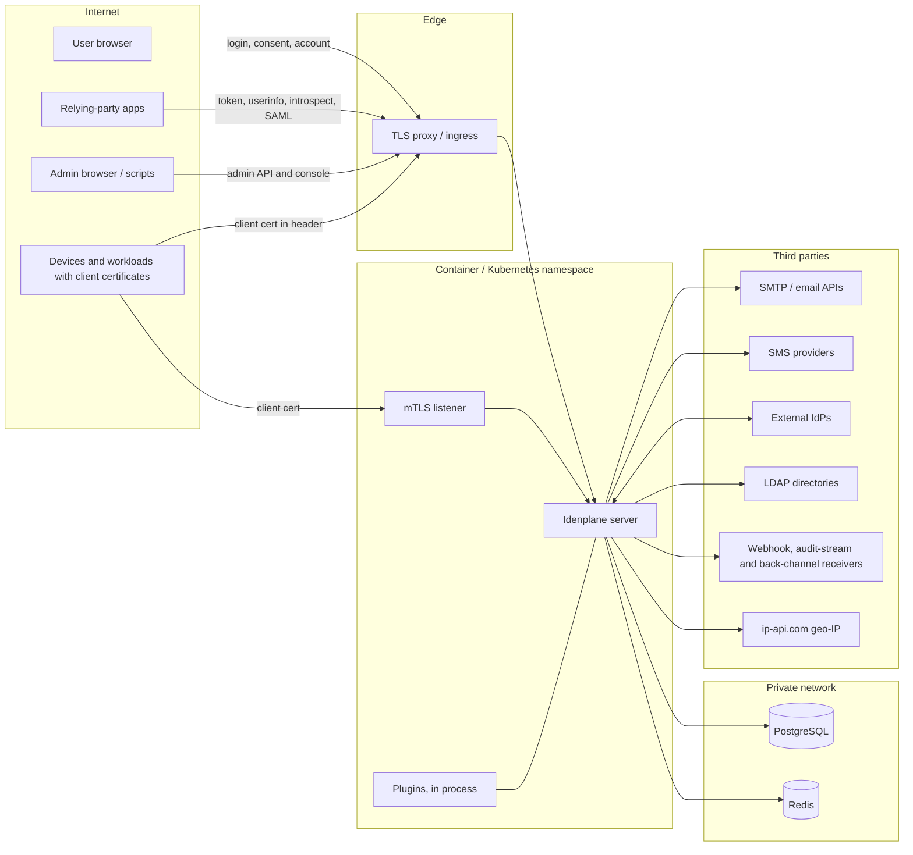
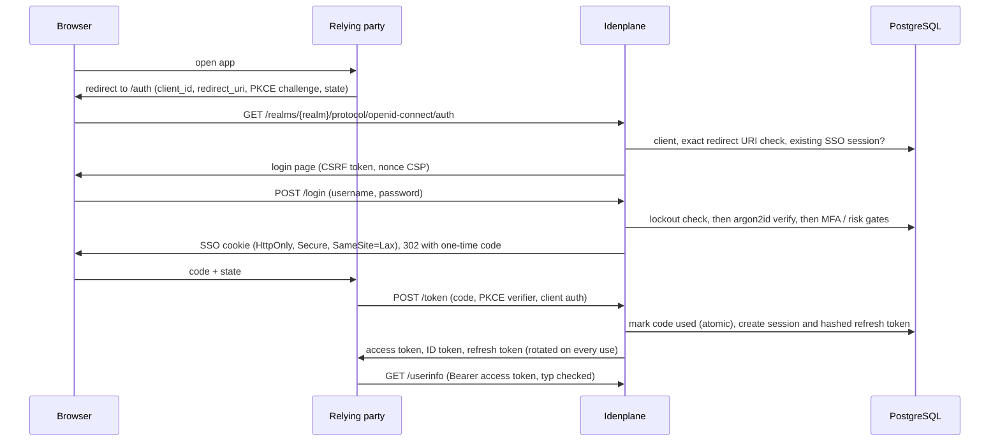

# Threat model

This is a STRIDE threat model of an Idenplane deployment: the server (`src/`), the admin console (`admin-ui/`), the hosted login and account pages (`themes/`), and what they talk to. It is written from the code as of 0.10.0 and updated for 0.11.0 (admin console MFA). Each mitigation names the file or feature that implements it; each residual risk is what is left after it.

It complements the [OWASP ASVS self-assessment](./asvs-assessment.md), which goes requirement by requirement, and the [secure defaults](./secure-defaults.md).

## Scope and assumptions

**In scope:** the Idenplane server and its admin, OAuth/OIDC, SAML IdP, SCIM, account and hosted-login endpoints; the admin console; the official Docker image and Helm chart; the integrations Idenplane initiates (SMTP and email APIs, SMS providers, LDAP, external IdPs, webhooks, audit streams, back-channel logout).

**Assumptions.** The model relies on these. If one does not hold, the matching threats get worse.

1. **TLS terminates at a reverse proxy or ingress** in front of the server (the app listens on plain HTTP). The proxy redirects HTTP to HTTPS and forwards only to Idenplane. The optional mTLS listener is the one place the server terminates TLS itself.
2. **`TRUSTED_PROXIES` names only that proxy.** The client IP used by rate limits, lockout records and audit events comes from `X-Forwarded-For` only when the peer is trusted (`src/common/utils/proxy-ip.util.ts`). `TRUSTED_PROXIES=*` trusts everyone.
3. **PostgreSQL and Redis are on a private network** reachable only by Idenplane, with their own credentials.
4. **The host is trusted.** Whoever controls the container, the Kubernetes namespace or the environment variables controls Idenplane: they hold the encryption key, the database credentials and the admin API key.
5. **Plugins are trusted code.** A plugin runs in the server process with its full privileges (`src/plugins/plugin-loader.service.ts`).
6. **Operators keep secrets secret**: `ENCRYPTION_KEY`/`WEBHOOK_SECRET_KEY`, `ADMIN_API_KEY`, `ADMIN_PASSWORD`, `DATABASE_URL`, provider API keys.

**Out of scope:** the security of relying-party applications themselves, of external IdPs and LDAP directories, of SMTP and SMS providers, of the browser and the user's device; physical and social-engineering attacks; denial of service by volume (that is the proxy's or the platform's job); vulnerabilities in third-party dependencies not yet disclosed upstream.

## Assets

| Asset | Where it lives | Why it matters |
|---|---|---|
| **User credentials**: password hashes, TOTP secrets, recovery codes, passkey public keys, phone numbers | PostgreSQL (`users`, `user_credentials`, `recovery_codes`, `webauthn_credentials`) | Account takeover, credential stuffing elsewhere. Passwords are argon2id; TOTP secrets and phone numbers are encrypted at rest. |
| **Tokens**: access, ID, refresh and offline tokens, authorization codes, device codes, magic-link and reset tokens | Access and ID tokens are signed JWTs held by clients; refresh tokens, codes and one-time tokens are stored as SHA-256 hashes | Session hijacking, impersonation of users towards relying parties. |
| **Signing keys** (per realm, RSA) | `realm_signing_keys`, private key encrypted at rest | Forging any token for any user of the realm. |
| **Encryption keys** (AES-256-GCM key ring) | Environment (`ENCRYPTION_KEY` or `WEBHOOK_SECRET_KEY`, previous key for rotation) | Decrypting every secret stored at rest. |
| **Sessions**: SSO sessions, OAuth sessions, admin sessions | `login_sessions`, `sessions` (hashed tokens); browser cookies; admin access token in console memory, refresh in an HttpOnly cookie | Acting as the user or admin without credentials. |
| **Admin access**: super-admin, realm-admin, view-only accounts; `ADMIN_API_KEY` | Master realm users; environment | Full control of every realm. |
| **Realm configuration**: clients and secrets, redirect URIs, IdP and LDAP settings, SMTP/SMS provider secrets, flows, themes | PostgreSQL; secrets encrypted at rest (`src/crypto/stored-secrets.ts`, `src/secrets-at-rest/`) | A changed redirect URI, IdP or flow is a takeover of every user of the realm. |
| **PII**: names, emails, phone numbers, IP addresses, user agents, login history, custom attributes | PostgreSQL; logs; events; outbound email and SMS | Privacy and regulatory exposure. |
| **Audit trail**: login and admin events, NHI audit logs, upgrade audit | PostgreSQL; optional audit streams | Detection and forensics; an attacker wants to erase it. |

### Cryptographic inventory

| Purpose | Algorithm and parameters | Code |
|---|---|---|
| Password hashing | argon2id, 64 MiB, t=3, p=4; passwords up to 1024 characters; concurrency capped | `src/crypto/crypto.service.ts` |
| Imported legacy hashes | bcrypt, PBKDF2 and others, verified once then rehashed to argon2id | `src/migration/password-migration.service.ts` |
| Token signing | RS256, one RSA 2048 key pair per realm (key id in the header) | `src/crypto/jwk.service.ts` |
| Secrets at rest | AES-256-GCM, random 96-bit IV, key id bound as AAD; key derived with scrypt; previous key kept for rotation | `src/crypto/key-ring.ts` |
| Opaque tokens (refresh, session, codes, reset, magic link) | 256- to 512-bit values from `crypto.randomBytes`, stored as SHA-256 | `src/crypto/crypto.service.ts` |
| OTP codes | `crypto.randomInt`, 6+ digits; SMS codes bound to the flow with HMAC-SHA256 | `src/sms/sms-otp.service.ts`, `src/auth-flow/email-otp.service.ts` |
| TOTP | RFC 6238, HMAC-SHA1 (authenticator-app compatibility), 160-bit secret | `src/mfa/mfa.service.ts` |
| Recovery codes | 120-bit random (base32), SHA-256 with an `rc2$` prefix; codes from before 0.11.0 rewrapped as Argon2id(old SHA-256) | `src/mfa/recovery-codes.ts`, `src/mfa/recovery-code-rewrap.service.ts` |
| Webhook signatures | HMAC-SHA256 | `src/webhooks/` |
| SAML | Assertions and responses signed with XML-DSig RSA-SHA256. AuthnRequests verified with RSA-SHA256 or RSA-SHA512 (SHA-256/512 digests); SHA-1 refused | `src/saml/saml-idp.service.ts`, `src/saml/saml-request-verifier.ts` |
| mTLS | X.509 path validation per realm, `x5t#S256` thumbprints, TLS 1.2+ on the listener | `src/client-auth/`, `src/mtls/` |

## Trust boundaries and data flows

The main flows:

Admin flow: the console signs in at `POST /admin/auth/login` against the `master` realm (lockout checked first). An admin with a second factor answers it at `/admin/auth/login/mfa` or `/login/passkey` (0.11.0); then the console gets a one-hour admin JWT (`typ: admin`, with `amr`, `acr` and `auth_time`) and an HttpOnly refresh cookie. Every admin request goes through `AdminApiKeyGuard` (authentication) and `AdminAuthorizationGuard` (role and realm scope, read from the database on each request).

## Threats by boundary

Each table lists the STRIDE category (S spoofing, T tampering, R repudiation, I information disclosure, D denial of service, E elevation of privilege), the threat, the mitigation in the code, and the residual risk.

### 1. Browser to hosted login, consent and account pages

| | Threat | Mitigation | Residual risk |
|---|---|---|---|
| S | Online password guessing and credential stuffing | Brute-force lockout, on by default for new realms, checked before any credential check (`src/brute-force/`, `src/login/login.service.ts`, `src/realms/realm-security-defaults.ts`); optional per-IP and per-user rate limits (`src/rate-limit/`), CAPTCHA, MFA, passkeys | Realms created before 0.10.0 may still have lockout off; rate limits are opt-in; no breached-password check |
| S | A locked account used as a password oracle | The lock is checked before the password, LDAP bind or device approval; same answer for right and wrong passwords (`test/secure-realm-defaults.e2e-spec.ts`) | The "locked" message reveals that the account exists |
| D | Lockout used to keep a user out | Temporary 5-minute lock, no permanent lockout by default, admin unlock, events and log on every lockout | A known username can be kept locked by an attacker who keeps trying |
| T | CSRF on login, consent, account and MFA forms | Double-submit CSRF tokens (`src/common/csrf/`), SameSite cookies | Account-console logout is a GET (ASVS V3.5.3) |
| T | XSS in themed pages | Handlebars auto-escaping, nonce-based CSP, `frame-ancestors 'none'` (`src/theme/theme-render.service.ts`) | Admin-supplied custom CSS is filtered by blocklist; request values in inline JS are HTML-escaped only |
| S | Session fixation and theft | New session token at sign-in, token stored hashed, `HttpOnly; Secure; SameSite=Lax` cookie scoped to the realm path (`src/login/session-issuer.service.ts`) | The SSO idle timeout (`ssoSessionIdleTimeout`, 0.12.0) is off by default; no `__Host-` prefix |
| I | Account enumeration through reset and registration | Generic answers on forgot-password; rate limits | Timing differs between known and unknown usernames (ASVS L3) |
| S | Old sessions survive a credential change | A password reset or change, an admin password set and an admin MFA reset end every session, offline ones included, and revoke refresh tokens; the account console keeps only the session that made the change (`src/sessions/sessions.service.ts`, 0.12.0) | Access tokens already issued stay valid until they expire (5 minutes by default) |
| E | Second-factor bypass | Server-side pending-action state, single-use challenges, TOTP replay protection (`src/mfa/`, `test/totp-replay.e2e-spec.ts`); 120-bit recovery codes (0.11.0) | — |

### 2. Relying-party apps to OAuth, OIDC and SAML endpoints

| | Threat | Mitigation | Residual risk |
|---|---|---|---|
| S | Code interception or injection | Codes live 60 s and are single-use (atomic update, replay revokes the session); PKCE `S256` required for public clients (`src/oauth/oauth.service.ts`, `src/auth/auth.service.ts`) | PKCE is optional for confidential clients |
| S | Open redirect via `redirect_uri` | Exact string matching of registered URIs since 0.11.0, loopback port excepted (RFC 8252); fragments refused (`src/common/redirect-uri.utils.ts`) | Clients upgraded with `allowInsecureWildcardRedirectUris` still match any path below a `/*` entry until an admin turns it off; `/admin/upgrade/health` lists them |
| S | Refresh token theft | Rotation on every use; reuse revokes the session; tokens bound to the client and optionally to a client certificate (RFC 8705); the session's absolute expiry is checked at every refresh (`src/sessions/session-lifetime.ts`) | An offline token is valid for `offlineTokenLifespan` (30 days by default) from sign-in, with no idle timeout; RP-initiated logout and the admin and reset paths end it, but a stolen one is usable until then |
| E | Token confusion: ID, logout or admin tokens used as access tokens | userinfo, introspection and the WebSocket accept only `typ: Bearer` (`src/tokens/access-token-type.ts`); admin API requires `typ: admin` | No audience or issuer check at verification (ASVS V9.2.3) |
| S | Client impersonation | Secrets hashed; one auth method per request; `tls_client_auth` / `self_signed_tls_client_auth` with per-realm trust anchors (`src/client-auth/`) | The password grant can still be enabled per client |
| T | SAML request tampering, XML attacks, signature wrapping | When the SP has a certificate, every AuthnRequest must be signed. HTTP-POST: one signature, on the root, referencing the root's `ID`, and every field read from the signed bytes; HTTP-Redirect: signature over the raw query bytes. No DTD, comments, processing instructions or duplicate IDs; SHA-1 refused; size limit before and during inflation (`src/saml/saml-request-verifier.ts`, `src/saml/saml-request-hardening.spec.ts`) | SPs without a certificate send unsigned requests, which anyone can forge (the response still goes only to a registered ACS URL) |
| S | Replay of a captured AuthnRequest | `IssueInstant` at most 5 minutes old (plus 3 minutes of skew); `Destination` checked; each request `ID` accepted once per SP, by a unique row in PostgreSQL shared by every replica and worker (`saml_request_ids`, `test/saml-request-replay.e2e-spec.ts`) | `ForceAuthn` and `IsPassive` are not acted on; SAML logout is not implemented |
| R | Denying a sign-in or token issuance | Login events on by default for new realms (`src/events/`) | Older realms may have events off |
| I | Forced logout via RP-initiated logout | `post_logout_redirect_uri` checked | GET logout without `id_token_hint` needs no confirmation (ASVS V10.6.2) |

### 3. Admin console and admin API

| | Threat | Mitigation | Residual risk |
|---|---|---|---|
| S | Admin password guessing or a stolen admin password | Master realm lockout on by default, per-IP admin login limit (`src/admin-auth/admin-auth.service.ts`), random initial password, weak passwords refused in production (`src/admin-auth/admin-seed.service.ts`). Since 0.11.0 a second factor at console sign-in (TOTP, passkey or recovery code) once the admin has one; wrong codes count towards the lockout. A server-wide requirement, on for new installs, confines an admin without a factor to enrolment (`src/admin-mfa/`, `src/common/guards/admin-authorization.guard.ts`, [Admin console MFA](./admin-mfa.md)) | Off after an upgrade until a super-admin or `ADMIN_MFA_REQUIRED` turns it on (`/admin/upgrade/health` warns). While required, someone with the password of an admin who has no factor yet can enrol their own |
| E | A realm-admin or view-only admin reaching other realms or the master realm | Global `AdminAuthorizationGuard`, roles and realm assignments read from the database per request, master never in a realm-admin scope, DB trigger on assignments, child ids confined to the path realm (`src/admin-rbac/`, `test/admin-rbac.e2e-spec.ts`) | — |
| S | Leaked `ADMIN_API_KEY` | Placeholder keys refused in production; per-IP limits on API-key use; end-user MFA resets and unlocks refuse the key. Its admin MFA reset (break-glass) is always recorded as an admin event | The key is static and grants super-admin, including resetting an admin's MFA |
| E | Stolen admin session used for sensitive changes | Removing a factor, new recovery codes, resetting another admin's MFA, turning the MFA requirement off, end-user MFA resets and unlocks need a second factor checked in the last 15 minutes (step-up, 0.11.0); the requirement can be pinned with `ADMIN_MFA_REQUIRED=true` | An admin MFA reset does not end that admin's open sessions; they expire within an hour |
| T | Changing a client, IdP or flow to take over a realm | Role checks; admin events on by default for new realms; clearing events is super-admin only | A compromised super-admin can do anything |
| I | Secrets read back through the API | GETs mask secrets; export with secrets is super-admin only | — |
| T | Admin XSS | React rendering; theme preview iframe sandboxed without same origin | Console shares an origin with realm pages |

### 4. Database (PostgreSQL)

| | Threat | Mitigation | Residual risk |
|---|---|---|---|
| I | Database dump or backup leaks | Passwords argon2id; tokens and codes hashed (recovery codes 120-bit since 0.11.0, older ones rewrapped in Argon2id); signing keys, TOTP secrets, phone numbers and provider secrets encrypted with AES-256-GCM; encryption key not in the database | Emails and other PII are plaintext |
| T | SQL injection | Prisma throughout; raw SQL only with constants | — |
| T | Race conditions on counters and single-use values | Serializable transactions with retry for lockout counting (`test/brute-force-concurrency.e2e-spec.ts`); atomic `used=false` updates for codes | Registration and password reset are not one transaction |
| E | Over-privileged database role | — | One role runs migrations and the app |

### 5. Redis

| | Threat | Mitigation | Residual risk |
|---|---|---|---|
| T | Poisoned cache (realm or client config) | Redis is optional; cache entries are invalidated through the cache bus; authorization decisions read the database | Anyone who can write to Redis can change cached config until it expires; production compose runs Redis without a password |
| D | Redis down | Falls back to the database and an in-memory token blacklist (`src/tokens/token-blacklist.service.ts`) | A revoked token may pass on another instance until the database check |

### 6. SMTP and SMS providers

| | Threat | Mitigation | Residual risk |
|---|---|---|---|
| I | Codes or links read in transit | Short lifetimes, single use, flow binding | SMTP STARTTLS is opportunistic unless `smtpSecure`; SMS is weak by nature |
| T | Email HTML injection | Templates escape values; the lockout email escapes username and realm name | — |
| D | SMS pumping and cost abuse | Per-user send limits and windows (`src/sms/sms-otp.service.ts`) | — |
| I | Recipients in logs | — | Provider adapters log email addresses and phone numbers at info level (ASVS V16.2.5) |

### 7. External IdPs (brokering)

| | Threat | Mitigation | Residual risk |
|---|---|---|---|
| S | Account linking to the wrong local user | Links keyed on (IdP, subject); email auto-link only with `trustEmail` and a verified email (`src/broker/broker.service.ts`) | — |
| S | Login CSRF on the callback | Per-IdP callback; signed state; flow-path state bound to the browser transaction | The legacy path's state is not bound to the browser, and no PKCE is sent upstream |
| S | Forged upstream identity | Identity comes from the IdP's userinfo endpoint over TLS with the IdP's access token | The upstream ID token is not verified; upstream acr/amr ignored |

### 8. LDAP

| | Threat | Mitigation | Residual risk |
|---|---|---|---|
| T | LDAP injection | Filter values escaped (`src/user-federation/ldap.client.ts`) | Base filter is admin config |
| S | Password guessing through LDAP | Failed binds count towards the lockout; a locked account is refused before the bind (0.10.0) | — |
| I | Bind credentials or passwords in transit | `ldaps`/StartTLS with certificate verification; bind password encrypted at rest | Plain `ldap://` is allowed if configured |

### 9. mTLS proxy and listener

| | Threat | Mitigation | Residual risk |
|---|---|---|---|
| S | Forged client-certificate header | Header accepted only from `MTLS_TRUSTED_PROXY_CIDRS` matched against the socket peer; `*` refused; untrusted headers rejected or stripped; startup exits on bad config (`src/mtls/`, `src/main.ts`) | Depends on the proxy stripping the header from clients |
| S | Certificate accepted without a trusted path | Handshake proves possession only; trust decided per realm per request (CA flags, EKU, path length, deny-list) | No CRL/OCSP yet (per-realm deny-list only) |
| E | Stolen bound token used without the key | `cnf` `x5t#S256` checked at userinfo, WebSocket and admin JWT auth | — |
| D | Certificate auth brute force | Per-(realm, thumbprint) failure budget | — |

### 10. Plugins, webhooks, audit streams and back-channel logout

| | Threat | Mitigation | Residual risk |
|---|---|---|---|
| E | Malicious plugin | Plugins load only from the local `plugins/` directory and installed packages; admin plugin routes are super-admin only | A plugin runs with full server privileges; there is no sandbox |
| S | SSRF through admin- or client-configured URLs | Webhooks and the SMS webhook use `safe-http-client` (DNS pinning, private ranges blocked); back-channel logout and audit streams no longer follow redirects | Back-channel logout, audit streams and broker calls do not use the SSRF guard |
| T | Forged webhook deliveries | HMAC-SHA256 signatures; secrets encrypted at rest | — |
| I | Event data to third parties | Admin-event redaction of sensitive fields | Receivers get PII by design |
| I | User IPs to a geo-IP service | Off unless adaptive auth or continuous verification is on | Sent over plain HTTP to ip-api.com |

### 11. Container and Kubernetes host

| | Threat | Mitigation | Residual risk |
|---|---|---|---|
| E | Container escape or privilege use | Non-root user, `allowPrivilegeEscalation: false`, all capabilities dropped (Helm) | Root filesystem is writable |
| I | Secrets in environment variables | Helm `existingSecret` support; placeholders refused in production | Every secret is visible to the whole process and to anyone who can read the pod spec |
| I | Debug and documentation endpoints | Stack traces hidden in production; `/health/ready` gives no error detail; there is no GraphQL endpoint | Swagger UI (`/api`) is public by design |
| T | Tampered image | Multi-stage build, `npm ci --omit=dev` | No SBOM or signature published |

## Residual risk summary

The highest residual risks, all tracked in the [ASVS assessment](./asvs-assessment.md#remaining-gaps):

1. Installs upgraded to 0.11.0 that have not turned on the admin MFA requirement. `/admin/upgrade/health` warns and names the admins without a second factor.
2. Clients still on the legacy wildcard redirect URI opt-in (`allowInsecureWildcardRedirectUris`, set by the 0.11.0 upgrade on clients that had `/*` entries). `/admin/upgrade/health` lists them.
3. Realms created before 0.10.0 with brute-force protection or events still off. `/admin/upgrade/health` lists them.
4. SSRF guard not applied to every outbound call; geo-IP over plain HTTP.
5. The SSO idle timeout is off by default (`ssoSessionIdleTimeout`, since 0.12.0), and offline sessions have none: an offline token lives for `offlineTokenLifespan` from sign-in.
